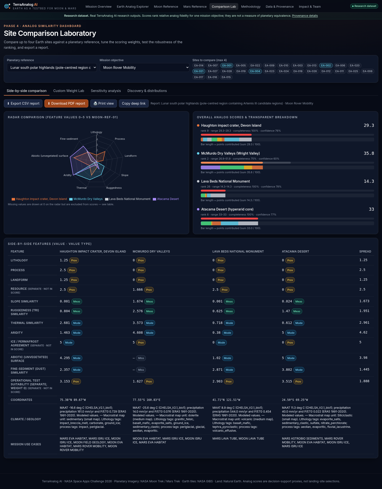
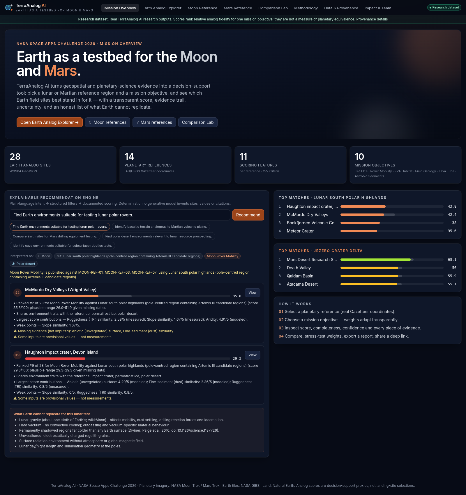
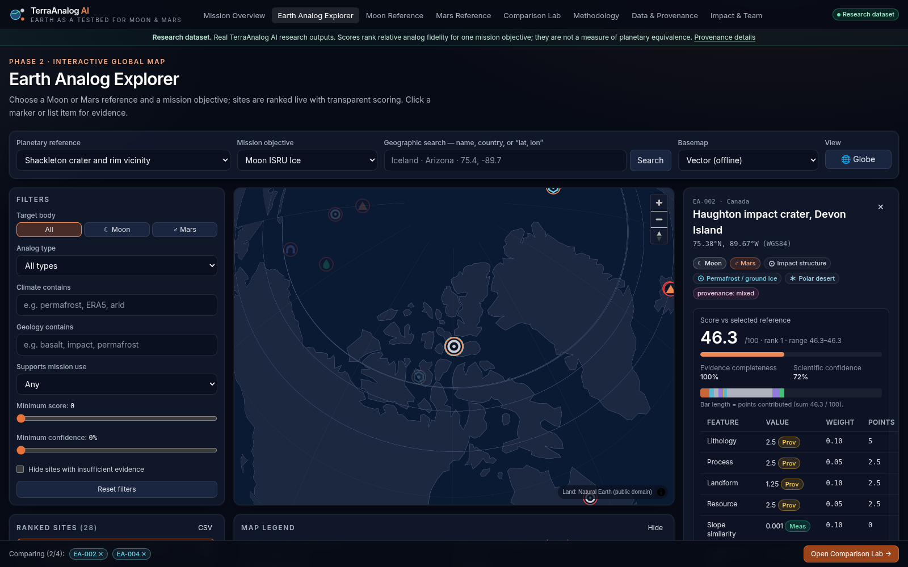
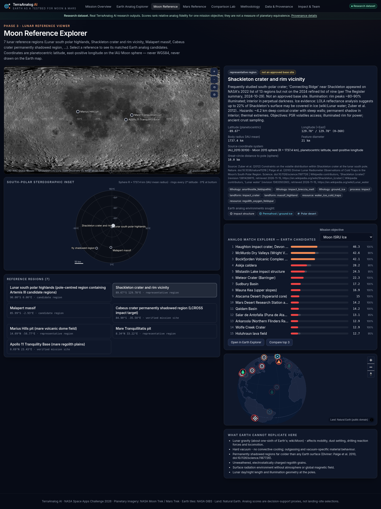
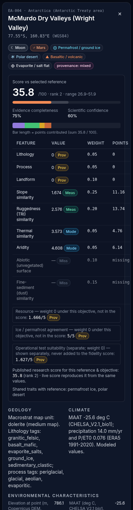

# TerraAnalog AI — Earth as a Testbed for the Moon and Mars

**An evidence-traceable decision-support platform that ranks Earth field sites as analogs for testing lunar and Martian mission
hardware, procedures and crews.** Built 2026-11-15 for the **NASA Space Apps Challenge 2026**.

Pick a Moon or Mars reference region and a mission objective (ISRU ice, rover mobility, EVA/habitat, field geology, lava-tube
exploration, astrobiology sediments) and TerraAnalog AI ranks 28 Earth analog sites on an interactive globe. Each score comes with a
transparent breakdown, evidence completeness, confidence, a source and citation for every value, a sensitivity analysis, and an
explicit list of what Earth cannot replicate.

> **Read this first.** A TerraAnalog score ranks the *relative surface/process analog fidelity of an Earth site for one specific mission objective*, using the features that data exists for. It is **not** a measure of lunar or Martian equivalence. No Earth site reproduces lunar or Martian gravity, vacuum or thin CO₂ atmosphere, radiation or temperature regime. **Operational test suitability** (access, trafficability, climate workability, permits, infrastructure) is scored **separately** and is never mixed into fidelity. The planetary reference locations are verified mission sites, candidate regions or representative regions. **None is an approved permanent base site.**



## Repository layout
| Path | What it is |
|---|---|
| [`app/`](app/) | **The web application.** FastAPI scoring/data service (`app/backend`), Next.js 15 UI (`app/web`), tests, Docker Compose, one-command setup scripts and docs ([`app/README.md`](app/README.md)) |
| [`app/data/research/`](app/data/research/) | The 9-file app data contract exported from this pipeline by `scripts/13_export_app_contract.py`, copied so the app runs standalone |
| [`app/data/fixtures/`](app/data/fixtures/) | Clearly labelled synthetic fallback data (only used if you point `TERRA_DATA_DIR` at it) |
| `scripts/`, `config/`, `outputs/`, `schemas/`, `data/processed/` | **The research pipeline**: data retrieval, feature extraction, similarity engine, sensitivity, analytics, validation (see [Research pipeline](#research-pipeline) below) |
| `scientific_methodology.md`, `source_references.md`, `data_contract.md` | Methods, verified references, and the data dictionary |
| [`render.yaml`](render.yaml) | One-click Render Blueprint for deploying the app |

## Quick start (run the app locally)
Prerequisites: **Python 3.11+** and **Node.js 20+**. Docker is optional.

**Windows (PowerShell 5.1 or 7):**
```powershell
git clone https://github.com/ThynkAI/terraanalog-ai.git
cd terraanalog-ai\app
powershell -ExecutionPolicy Bypass -File scripts\setup.ps1
```
**macOS / Linux:**
```bash
git clone https://github.com/ThynkAI/terraanalog-ai.git
cd terraanalog-ai/app
./scripts/setup.sh
```
**Docker:**
```bash
cd terraanalog-ai/app
docker compose up --build
```
Then open **http://localhost:3000**. The API docs are at http://localhost:8000/docs. The setup scripts create a virtualenv, install
dependencies, build the UI and start both servers. Options such as dev mode, other ports, running the tests, or using the synthetic data
are covered in [`app/README.md`](app/README.md).

## Screenshots
| | |
|---|---|
|  |  |
| Mission overview and the explainable recommendation engine | Earth Analog Explorer: globe, ranked sites, score breakdown with value-type badges |
|  |  |
| Moon Reference Explorer (planetocentric coordinates, never WGS84) | Site detail: measured / modeled / provisional values, and missing values shown as "—" (never imputed) |

All screenshots: [`app/docs/screenshots/`](app/docs/screenshots/). A sample generated PDF report: [`app/docs/samples/site-comparison-report-sample.pdf`](app/docs/samples/site-comparison-report-sample.pdf).

## Scientific case studies

Open **Science Cases** (`/science`) for three source-reviewed investigations: Holuhraun–Elysium mobility, Undara–Tranquillitatis cave robotics and Svalbard–Shackleton polar procedures. Each includes same-reference benchmark comparisons, regional measurements with spatial support, assumption stress tests, published evidence-strict summaries, source links and evidence exports. These are research investigations, not claims of new field-validated analog discoveries. See [`app/docs/SCIENTIFIC_CASE_REVIEW.md`](app/docs/SCIENTIFIC_CASE_REVIEW.md).

## How the AI works
TerraAnalog AI is **explainable AI for decision support**. It does not use a chatbot or a large language model, so nothing can invent a site, a value or a citation.
1. **Feature extraction (research pipeline):** open geospatial datasets (Copernicus DEM, ESA WorldCover, CHELSA, ERA5, SoilGrids,
   permafrost models, Macrostrat, LRO LOLA, MGS MOLA) and quoted literature are turned into 11 comparable features per site.
2. **Similarity engine:** each Earth site is compared with each lunar or Martian reference using transparent functions (Jaccard on
   controlled-vocabulary tags, Gaussian or log-ratio kernels on terrain and thermal values, threshold decay on aridity).
3. **Multi-criteria scoring:** `score = 100 · Σ w·sim / Σ w` over the features that have data. Weights are body × reference ×
   mission objective × user, and every weight is visible and adjustable in the Custom Weight Lab. Missing data lowers *evidence
   completeness* and widens the plausible score range; it is **never imputed**. Operational suitability is scored separately.
4. **Uncertainty and discovery:** Monte Carlo / one-at-a-time sensitivity and rank-stability analysis; unsupervised PCA and
   k-means clustering to find families of similar environments (shown on a deck.gl arc map).
5. **Recommendation engine:** type a plain-language request such as *"Identify cave environments suitable for subsurface robotics
   tests"*. Deterministic keyword parsing turns it into structured filters (body, reference, mission objective, analog types). It then
   runs the documented scoring, shows its interpretation, explains *why* each site ranks where it does, lists caveats, and states what
   Earth cannot replicate.

The app recomputes all 588 published research scores with all ranks in agreement and a maximum unrounded difference of 0.00004737 points
([`app/docs/TEST_RESULTS.md`](app/docs/TEST_RESULTS.md#final-submission-pass)). No ML model is trained and no predictive accuracy is claimed.

## Data provenance
* Each value is labelled **measured**, **modeled**, **provisional** or **missing**, with a source ID and citation. The app's *Data & Provenance*
  page shows the dataset catalog, file validation and ID-consistency checks.
* Earth sites use WGS84. Moon and Mars references use planetocentric, east-positive body-fixed coordinates (IAU_2015:30100 /
  IAU_2015:49900) and are never drawn on an Earth map.
* Data sources actually used, unavailable sources and licences are listed below and in `outputs/dataset_catalog.csv`.
  Imagery tiles (NASA GIBS, NASA Moon/Mars Trek) are loaded at runtime from NASA and are not redistributed in this repository.
* Scores are relative, objective-specific fidelity proxies for planning field tests. They are **not** landing-site selections or
  hardware qualification.

## Deploy
**Render (one click):** in the Render Dashboard choose **New → Blueprint** and select this repository. [`render.yaml`](render.yaml) creates
two Starter (always-on) web services:
* `terraanalog-api`: FastAPI, rootDir `app`, `TERRA_DATA_DIR=data/research`, health check `/api/health`.
* `terraanalog-web`: Next.js, rootDir `app/web`. Its server-side `/api/*` proxy is wired to the API through `API_HOST` (the API service's
  public hostname, filled in automatically by the Blueprint).

No secrets or environment values need to be entered. The live deployment runs on Render Starter instances, which do not sleep when
idle (if you deploy on the free plan instead, the first request after an idle pause can take about a minute). Other options include any Docker host (`app/docker-compose.yml`) and the notes in
[`app/docs/DEPLOYMENT.md`](app/docs/DEPLOYMENT.md).

**Live demo (verified 15 November 2026, America/Toronto):**
* App: https://terraanalog-web-cqgu.onrender.com
* API: https://terraanalog-api-cqgu.onrender.com/api/health ( returns `synthetic: false`, 28 sites, 14 references)

## Team and NASA Space Apps
Built for the NASA Space Apps Challenge 2026 by Deep Kanabar (lead), with AI assistants for the planetary-science and geospatial
research pipeline and for the software platform. NASA does not endorse this project. NASA data is used under NASA's open data policy,
and other data sources are credited below and in the app.

---

# Research pipeline

## What is in the package

| Path | Contents |
|---|---|
| `outputs/earth_analog_sites.geojson` | 28 Earth sites (`EA-001`…`EA-028`), WGS84 points with bbox, summary properties and per-profile scores |
| `outputs/earth_analog_site_bounds.geojson` | Approximate site bounding polygons (not legal or park boundaries) |
| `outputs/planetary_reference_sites.geojson` | 7 Moon + 7 Mars references in body-fixed CRS (IAU_2015:30100 / IAU_2015:49900) |
| `outputs/analog_features.csv` | 82 columns of Earth features with explicit nulls |
| `outputs/planetary_features.csv` | Reference features (terrain from LOLA/MOLA) |
| `outputs/analog_rankings.csv` | 28 sites × 10 mission profiles: fidelity score, rank, completeness, confidence, operational score, Monte Carlo intervals, per-feature similarities |
| `outputs/dataset_catalog.csv` | 35 datasets with access, licence, credentials and whether each was used/blocked |
| `outputs/site_evidence.json` | Per-tag verbatim quotes with URLs, numeric-source requests, limitations and confidence |
| `outputs/scoring_config.json` | The exact configuration used (copy of `config/scoring_config.json`) |
| `outputs/sensitivity_summary.json`, `analytics_summary.json`, `radar_chart_data.json`, `similarity_matrix_*.csv`, `data_gaps.csv` | Uncertainty and unsupervised analytics |
| `outputs/figures/` | `site_map`, `pca_clusters`, `radar_<profile>` (×6), `sensitivity_rank_intervals` as PNG and SVG |
| `outputs/validation_report.md` / `validation_results.json` | Output of the validation suite (actually run) |
| `scientific_methodology.md` | Methods, formulas, provenance classes and limitations |
| `source_references.md` | Verified DOIs, datasets and web sources (generated from retrieval metadata) |
| `data_contract.md`, `schemas/` | CSV column dictionary and JSON Schemas for the web app |
| `HANDOFF_GROK_BOT_2.md` | Integration spec for the web-app builder |
| `config/` | Site master list, planetary references, scoring config and DOI list (the human-editable inputs) |
| `scripts/` | Full pipeline (see below) |

## Results snapshot (auto-generated by `scripts/12_results_snapshot.py`)

<!-- RESULTS:START -->
| Profile | #1 (score, completeness) | #2 | #3 | MC mean Spearman |
|---|---|---|---|---|
| MOON_ISRU_ICE | EA-002 Haughton impact crater (57.4, 1.00) | EA-004 McMurdo Dry Valleys (45.6, 0.90) | EA-007 Askja caldera (42.6, 1.00) | 0.912 |
| MOON_ROVER_MOBILITY | EA-028 Mars Desert Research Station area (77.2, 0.95) | EA-008 Timanfaya volcanic field (70.3, 0.95) | EA-011 Salar de Uyuni (67.3, 0.75) | 0.927 |
| MOON_EVA_HABITAT | EA-004 McMurdo Dry Valleys (50.9, 0.75) | EA-005 Bockfjorden Volcanic Complex (44.7, 1.00) | EA-002 Haughton impact crater (39.5, 1.00) | 0.937 |
| MOON_FIELD_GEOLOGY | EA-024 Mistastin Lake impact structure (51.1, 1.00) | EA-002 Haughton impact crater (44.5, 1.00) | EA-023 Meteor Crater (42.4, 1.00) | 0.948 |
| MOON_LAVA_TUBE | EA-009 Cueva de los Verdes lava tube (74.3, 0.95) | EA-016 Undara lava tubes (69.1, 0.95) | EA-008 Timanfaya volcanic field (59.8, 0.95) | 0.969 |
| MARS_ISRU_ICE | EA-002 Haughton impact crater (65.7, 1.00) | EA-004 McMurdo Dry Valleys (56.8, 0.95) | EA-007 Askja caldera (42.0, 1.00) | 0.909 |
| MARS_ROVER_MOBILITY | EA-028 Mars Desert Research Station area (71.5, 0.95) | EA-008 Timanfaya volcanic field (62.3, 0.95) | EA-006 Holuhraun lava field (61.7, 0.95) | 0.946 |
| MARS_EVA_HABITAT | EA-002 Haughton impact crater (57.2, 0.95) | EA-018 Qaidam Basin (53.9, 0.95) | EA-028 Mars Desert Research Station area (45.8, 0.95) | 0.925 |
| MARS_ASTROBIO_SEDIMENTS | EA-028 Mars Desert Research Station area (61.6, 1.00) | EA-003 Death Valley (51.6, 1.00) | EA-018 Qaidam Basin (50.3, 1.00) | 0.96 |
| MARS_LAVA_TUBE | EA-009 Cueva de los Verdes lava tube (57.5, 0.95) | EA-016 Undara lava tubes (51.4, 0.95) | EA-008 Timanfaya volcanic field (45.3, 0.95) | 0.953 |

Validation: **42/42 checks passed** (see `outputs/validation_report.md`).

Scores are relative, profile-specific fidelity (0-100), not planetary equivalence. Completeness = share of profile weight with data.
<!-- RESULTS:END -->

## Provenance classes

Each value is labelled **measured** (instrument data that was actually read, e.g. Copernicus DEM, LOLA, MOLA), **derived** (computed from measured data, e.g. slope, TRI, land-cover fractions, distances), **modeled** (model or reanalysis output, e.g. CHELSA, ERA5, SoilGrids, Obu permafrost), **literature** (quoted from a fetched source with URL) or **hypothesized** (an expert tag that the fetched text did not support; marked `?` in the config and tested by the evidence-strict variant). Missing data is `null`, never 0.

## Data sources actually used

* **Downloaded and processed:** Copernicus DEM GLO-30 (AWS COGs), ESA WorldCover 2021 v200 (AWS COGs), CHELSA V2.1 bioclim (COG range reads), ERA5 daily 1991–2020 via the Open-Meteo archive API, Obu et al. 2019 permafrost probability (PANGAEA), Macrostrat map units API, ISRIC SoilGrids 2.0 REST, Natural Earth (10m roads/populated places, 110m land), LRO LOLA LDEM_80S_80M (PDS) and LOLA 118 m global, and MGS MOLA 463 m (USGS mosaics, range reads).
* **Literature-sourced only (quoted, not ingested as rasters):** Wikipedia article text and GeoData coordinates, LROC pits atlas, NASA/NSSDCA pages, Diviner and LCROSS findings, plus peer-reviewed papers whose DOIs were verified via Crossref.
* **Unavailable or blocked (code provided, not used):** WorldClim 2.1 (TLS failure from the build host), OSM Overpass (TLS refused / 504), MODIS LST via AppEEARS and ERA5 via CDS (need Earthdata/CDS credentials), Landsat, Sentinel-2, HiRISE, CTX and CRISM (catalogued only).

## Regenerating the raw data

`data/raw/` (~2.3 GB: DEM tiles, LOLA polar DEM, PERPROB raster, cached API responses) is **not** in git. It is listed in `.gitignore`, and no committed file exceeds 5 MB. To rebuild it:

```bash
python -m venv .venv && . .venv/bin/activate
pip install -r requirements.txt            # needs GDAL wheels via rasterio
python scripts/run_all.py                  # 01-03 retrieval, then 04-12 processing and validation
# processing only, from an existing data/raw:
python scripts/run_all.py --offline
# selective re-retrieval, e.g. only climate for all sites:
python scripts/02_retrieve_earth_data.py --only era5,chelsa --refresh
# credentialed or blocked sources (optional):
EARTHDATA_TOKEN=... python scripts/retrieve_credentialed_or_blocked.py modis_lst
python scripts/retrieve_credentialed_or_blocked.py worldclim overpass
```

| Script | Role |
|---|---|
| `01_retrieve_literature.py` | Wikipedia extracts and GeoData, Crossref DOI verification, archived web pages |
| `02_retrieve_earth_data.py` | Copernicus DEM, WorldCover, CHELSA, ERA5 (Open-Meteo), permafrost, Macrostrat, SoilGrids, access distances |
| `01b_imagery.py` | Openly licensed lead image per site from Wikimedia Commons (licence, author, file page, HTTP 200 check) |
| `02b_soilgrids_nearby.py` | SoilGrids nearest valid pixel (<= 10 km, no interpolation) where the point pixel is masked |
| `02c_admin_region.py` | Admin-1 region per site (Natural Earth 1:10m, point-in-polygon) |
| `02d_climate_class.py` | Koppen-Geiger class (Peel et al. 2007) from ERA5 1991-2020 monthly normals, plus UNEP aridity class |
| `03_retrieve_planetary_data.py` | LOLA/MOLA terrain around each reference |
| `03b_gazetteer.py` | USGS/IAU Gazetteer of Planetary Nomenclature feature IDs and official diameters for the references |
| `04_build_features.py` | Feature table, planetary features, `site_evidence.json` |
| `05_score.py` | MCDA fidelity score, operational score, Monte Carlo / OAT / leave-one-out sensitivity, strict-evidence variant |
| `06_analytics.py` | PCA, k-means/Ward clustering, similarity matrices, radar data, baseline comparison, figures |
| `07_dataset_catalog.py` · `08_build_geojson.py` · `10_write_references.py` · `11_data_contract.py` | Catalog, GeoJSON, references, data contract and schemas |
| `09_validate.py` | Validation suite (geometry, coordinates, DOIs, units, score recalculation, sensitivity, plausibility, URLs) |
| `12_results_snapshot.py` | Refreshes the results tables in this README and the handoff |
| `13_export_app_contract.py` | Exports the 9-file web-app data contract (`terraanalog-ai/docs/DATA_INTEGRATION.md`) plus a `supplementary/` folder (data gaps, radar data, sensitivity, profile rankings with `mc_*`, site bounds): `python scripts/13_export_app_contract.py --out <dir>` (default `app_contract_export/`, git-ignored) |

Network retrieval of 28 sites takes roughly 1–2 h. SoilGrids is rate-limited, and Overpass is skipped after its first failure. Processing (`--offline`) takes about 2 min.

## Method in one paragraph

For each mission profile, a site's fidelity is `100 · Σ wᵢ·simᵢ / Σ wᵢ` over the features with data, against each of the profile's references. The best reference is kept. Similarities are transparent functions (Jaccard on controlled-vocabulary tags with documented equivalences, Gaussian or log-ratio kernels on terrain and thermal values, threshold-decay on aridity, and direct use of ice and abiotic fractions). `evidence_completeness` = Σ w over available features, and `confidence` is the weight-averaged provenance confidence. Analytics are unsupervised only (PCA and clustering). **No ML model is trained and no predictive accuracy is claimed.** There is no labelled ground truth. Details: `scientific_methodology.md`.

## Repository notes

* The repo root is the research package root; the web app lives in `app/` (added with its own commit history via `git subtree`). A zip of the package (without `data/raw/`) is produced as `terraanalog_package.zip`.
* Commits were pushed with `git` over HTTPS using the box's `gh` credential helper, not the GitHub MCP `push_files` tool, because that tool cannot carry binary PNGs or more than four file substitutions per call.

## Development and use of AI

TerraAnalog AI was conceived, specified and directed by the team. Deep Kanabar wrote the project specification, set the scientific and data-integrity rules, and directed, reviewed and validated all output. AI coding assistants were used to help write code, documentation and data-processing scripts under that direction.

The deployed application uses no generative AI at runtime. Scores are produced by a deterministic, explainable engine, and every value traces to a cited source. Missing measurements are shown as missing; they are never invented.

## Licence and data terms

* **Code** (research pipeline `scripts/`, the web app in `app/`, configs and tests): [MIT License](LICENSE), copyright 2026 Deep Kanabar / ThynkAI.
* **Research text** written for this project (README, `scientific_methodology.md`, `data_contract.md`, `app/docs/`) and **values
  derived by TerraAnalog** (similarity scores, rankings, completeness/confidence, the `TA-ENGINE` and `TA-PF-LOGISTIC` outputs):
  [CC BY 4.0](https://creativecommons.org/licenses/by/4.0/), unless an upstream licence below says otherwise.
* **Data files keep their upstream licences** (see `outputs/dataset_catalog.csv`, column `license_access`, and
  `app/data/research/dataset_catalog.csv`). Sources whose values or quotes appear in this repository:
  | Source | Licence |
  |---|---|
  | Copernicus DEM GLO-30 | Copernicus DEM licence (free, attribution required) |
  | ESA WorldCover 2021 v200 | CC BY 4.0 |
  | CHELSA V2.1 | CC BY 4.0 |
  | ERA5 via Open-Meteo | CC BY 4.0 (Open-Meteo); ERA5 under the Copernicus licence |
  | ISRIC SoilGrids 2.0 | CC BY 4.0 |
  | Macrostrat | CC BY 4.0 |
  | Obu et al. 2019 permafrost (PANGAEA) | CC BY 3.0 |
  | Natural Earth | public domain |
  | LRO LOLA, MGS MOLA, USGS Astrogeology, NASA PDS products (incl. Diviner, LCROSS, LROC, THEMIS literature values) | public domain (US Government) |
  | Wikipedia article text (quoted evidence sentences) | CC BY-SA 4.0 (each quote cites its article and revision) |

  Catalogued but not used, and not redistributed: WorldClim 2.1 (free for research), OSM (ODbL), MODIS/AppEEARS/Earthdata, Landsat,
  Sentinel-2, HiRISE, CTX, CRISM, PSA, OpenTopography, ESA CCI permafrost. Imagery tiles (NASA GIBS, NASA Moon/Mars Trek) load at runtime
  from NASA and are not stored in this repository. Raw rasters (`data/raw/`) are not committed.
