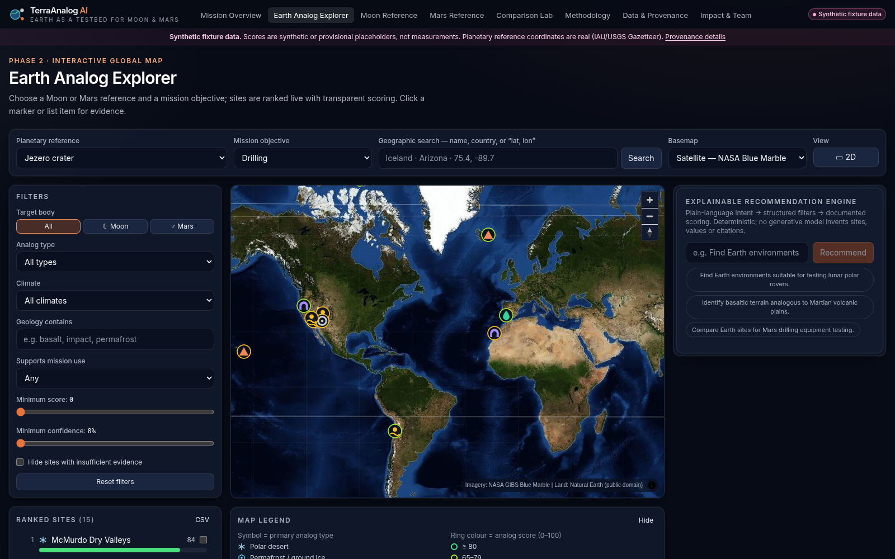

# TerraAnalog AI — Earth as a Testbed for Moon and Mars

Interactive decision-support platform (NASA Space Apps Challenge 2026) that ranks **terrestrial analog sites** for testing lunar and
Martian mission hardware, procedures and crews. Pick a Moon/Mars reference region and a mission objective → see ranked Earth sites on
a globe, with a transparent score breakdown, evidence completeness, confidence, sources, sensitivity analysis and an explicit list of
what Earth cannot replicate.

> ⚠️ **Data status: SYNTHETIC FIXTURES.** The research bot's authoritative files were not available when this build was made.
> `data/fixtures/` contains clearly-labelled synthetic/provisional values (the UI shows a *Synthetic fixture data* badge on every
> page). Planetary reference coordinates **are real** (IAU/USGS Gazetteer of Planetary Nomenclature, queried 2026-11-15).
> Swap in real data with `TERRA_DATA_DIR` — no code changes. See [docs/DATA_INTEGRATION.md](docs/DATA_INTEGRATION.md).



## Features
| Area | What you get |
|---|---|
| Earth Analog Explorer | MapLibre GL **globe / 2D** toggle, category-symbol markers (shape = analog type, ring = score), offline vector basemap + NASA GIBS satellite & terrain layers, filters (body, analog type, climate, geology, mission use, min score, min confidence, insufficient-evidence toggle), name or `lat, lon` geographic search with radius, ranked list, ranking chart with uncertainty whiskers, site detail panel, keyboard-accessible markers and legend, CSV export, deep links |
| Moon / Mars Reference Explorers | NASA Trek equirectangular imagery (LRO WAC mosaic, Viking MDIM 2.1) in a body-specific viewer, planetocentric/+East coordinates, south-polar stereographic inset on the IAU sphere, 14 Gazetteer-sourced references (Shackleton, Malapert, de Gerlache, Mare Tranquillitatis, Marius Hills, Rima Hadley, Jezero, Gale, Elysium Planitia, Utopia, Arsia Mons, Planum Australe, Meridiani…), Analog Match Explorer with matched Earth sites |
| Comparison Lab | radar comparison, side-by-side table with value-type badges, transparent score breakdown, **Custom Weight Lab** (live re-ranking), **sensitivity analysis** (weight sweeps + rank stability), **Analog Discovery** clusters, feature distributions, CSV report export, print-to-PDF, shareable links |
| Recommendation engine | `POST /api/recommend`: deterministic intent parsing → structured filters → documented scoring; explains *why* and lists caveats and non-replicable factors. No generative model; cannot invent sites or facts |
| Methodology & Provenance | methodology/references markdown loaded from the data dir, live weight tables, dataset catalog, file status, validation & ID-consistency report |

## Quick start (local)
Requirements: Python ≥ 3.11, Node ≥ 20.
```bash
make setup          # venv + pip, npm ci, Playwright Chromium
./scripts/dev.sh    # API on :8000 (FastAPI docs at /docs), UI on :3000
```
Manual equivalent:
```bash
python3 -m venv .venv && .venv/bin/pip install -r backend/requirements-dev.txt
.venv/bin/uvicorn app.main:app --app-dir backend --port 8000
cd web && npm ci && npm run build && API_URL=http://127.0.0.1:8000 npm start   # http://localhost:3000
```
Docker: `docker compose up --build` → UI http://localhost:3000, API http://localhost:8000/docs.

## Tests
```bash
make test-api   # pytest: schema, coordinates, scoring, filters, API, missing data, comparison, recommend
make test-web   # tsc + vitest unit tests
make test-e2e   # Playwright: pages, axe accessibility, mobile viewport, explorer/compare flows
```
Latest executed results: [docs/TEST_RESULTS.md](docs/TEST_RESULTS.md).

## Repository layout
```
backend/app/        FastAPI service: models.py (schemas), loader.py (validation + ID checks), scoring.py, analysis.py, recommend.py, main.py
backend/tests/      pytest suite
data/fixtures/      SYNTHETIC versions of the 9 contract files (generated by scripts/build_fixtures.py)
data/real/          drop-in folder for Bot 1's research outputs (git-ignored)
web/                Next.js 15 + React 19 + Tailwind + MapLibre GL 5 + Recharts UI; /api/* proxied server-side to FastAPI
web/e2e/            Playwright end-to-end + axe accessibility + mobile tests
docs/               architecture, data integration, deployment, pitch, demo script, presentation outline, screenshots
```

## Documentation
- [Architecture](docs/ARCHITECTURE.md) · [Data integration guide](docs/DATA_INTEGRATION.md) · [Deployment](docs/DEPLOYMENT.md)
- [Pitch](docs/PITCH.md) · [3-minute demo script](docs/DEMO_SCRIPT.md) · [Presentation outline](docs/PRESENTATION_OUTLINE.md)
- [Test results](docs/TEST_RESULTS.md) · [Screenshots](docs/screenshots/)

## Attribution
Planetary imagery: NASA Moon Trek (LRO WAC, NASA/GSFC/ASU) and NASA Mars Trek (Viking MDIM 2.1, NASA/JPL/USGS). Earth tiles: NASA GIBS
(Blue Marble; ASTER GDEM shaded relief, NASA/METI). Land polygons: Natural Earth (public domain). Planetary coordinates: Gazetteer of
Planetary Nomenclature (IAU WGPSN / USGS). Twelve site entries and their PREP_DRAFT factor scores come from the team's AnalogSite prep pack.

Analog scores are decision-support proxies — **not** landing-site selections and **not** flight-hardware qualification.
